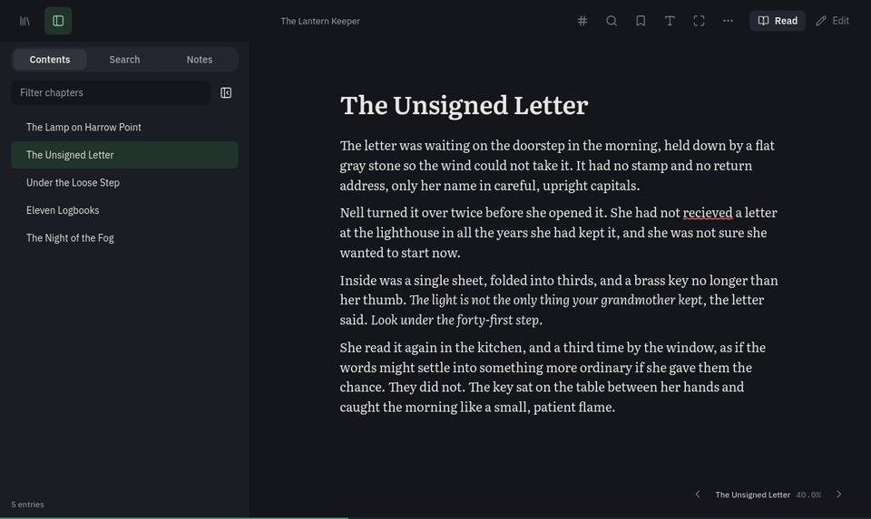
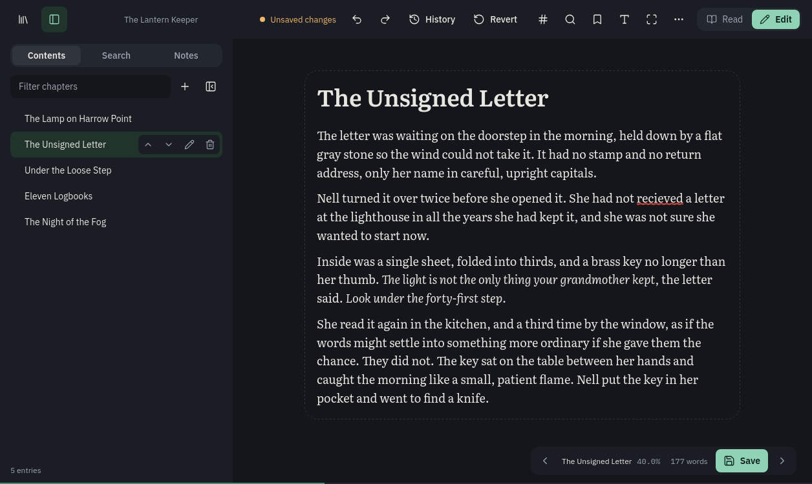
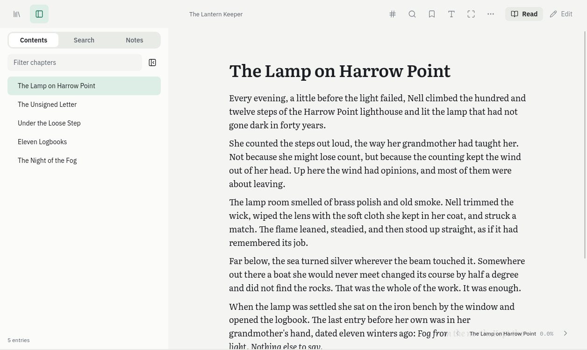

<div align="center">


# Jadeslip

**A fast desktop EPUB reader that lets you fix the book while you read it.**

Open a 6,000-chapter web novel in about a quarter of a second, spot a typo, press <kbd>E</kbd>, fix it, press <kbd>Esc</kbd>. Done. The fix is saved back into the EPUB.

**[Download for Windows](https://github.com/gravewhisper/jadeslip/releases/latest) · [Download for Linux](https://github.com/gravewhisper/jadeslip/releases/latest)** · free and open source

[](https://github.com/gravewhisper/jadeslip/releases/latest)
[](#download)
[](LICENSE)



</div>

---

## Download

Get the file for your system from the [latest release](https://github.com/gravewhisper/jadeslip/releases/latest).

| System | File | Size |
|---|---|---:|
| Windows 10 or 11, 64-bit | `Jadeslip_<version>_x64-setup.exe` | 5 MB |
| Linux, most distributions | `Jadeslip_<version>_amd64.AppImage` | 86 MB |
| Ubuntu, Debian, Linux Mint | `Jadeslip_<version>_amd64.deb` | 8 MB |

There is no macOS build yet.

**Windows.** Run the installer. Windows may say "Windows protected your PC", because the installer is not signed with a paid certificate yet. Click **More info**, then **Run anyway**. Jadeslip then appears in the Start menu. To update, run a newer installer over it. To uninstall, use **Settings › Apps**.

**Linux AppImage.** Make the file executable and run it:

```sh
chmod +x Jadeslip_*.AppImage
./Jadeslip_*.AppImage
```

Or right-click it in your file manager, allow it to run as a program, and double-click it. If it says "Cannot mount AppImage", install your distribution's `fuse3` package, or start it with `--appimage-extract-and-run`. To update, replace the file with a newer one.

**Ubuntu and Debian.** Install the package, which adds Jadeslip to your app menu:

```sh
sudo apt install ./Jadeslip_*_amd64.deb
```

**Check the download (optional).** Each release has a `SHA256SUMS` file. Put it in the same folder and run `sha256sum -c --ignore-missing SHA256SUMS` on Linux, or `Get-FileHash Jadeslip_*_x64-setup.exe` in PowerShell on Windows and compare the result with the line in `SHA256SUMS`.

## Your first book

1. Click **Add to shelf** and pick an EPUB. Jadeslip keeps its own copy, so the file you picked is never changed.
2. Click the book to start reading. Your place is remembered.
3. See a typo? Press <kbd>E</kbd>, fix it, then press <kbd>Esc</kbd>. The fix is saved into Jadeslip's copy of the book.
4. Changed your mind? **History** in the reader takes the book back to any earlier save.

Press <kbd>F1</kbd> at any time to see every shortcut.

## Screenshots


<table>
  <tr>
    <td width="50%"></td>
    <td width="50%"></td>
  </tr>
  <tr>
    <td align="center"><sub><b>Library.</b> Your shelf, with where you left off up top.</sub></td>
    <td align="center"><sub><b>Search.</b> Plain or regex, across every chapter.</sub></td>
  </tr>
  <tr>
    <td width="50%"></td>
    <td width="50%"></td>
  </tr>
  <tr>
    <td align="center"><sub><b>Edit.</b> Fix it right where you read it.</sub></td>
    <td align="center"><sub><b>Light theme.</b> Plus fonts, width, margins and page view.</sub></td>
  </tr>
</table>

<sub>The books in the screenshots are short samples written for this README and generated by <code>crates/fixtures</code>.</sub>

## Why

Calibre is great, but opening a huge web novel in it is slow, and fixing one wrong word means launching a whole separate editor. Jadeslip is built for exactly that case:

- **Huge books open instantly.** It reads only the index of the EPUB, never unpacks it to disk, and loads chapters on demand.
- **Reading and editing are one switch.** The same view, the same place in the chapter. A typo fix is a two-second interruption, not a context switch.
- **Your book is safe.** Saves are atomic, a no-change save leaves the file byte-for-byte identical, and there is always a way back.

Jadeslip is not a replacement for Calibre. Calibre converts between formats, sends books to e-readers, fetches metadata and has a full editor for every file inside a book. Jadeslip does none of that. It is a reader with a small, simple editor for fixing text as you go. For bigger jobs, keep using Calibre or Sigil.

## Features

| | |
|---|---|
| 📚 **Library** | A shelf with generated covers, progress, search, sort, and "pick up where you left off". |
| 📖 **Reader** | Contents sidebar, light and dark themes, adjustable font, width, margins and spacing, scroll or page view, focus mode, full screen. Your place is remembered. |
| ✏️ **Edit in place** | Press <kbd>E</kbd> to edit the chapter you are reading, <kbd>Esc</kbd> to save and go back. Bold, italic, headings, lists, undo across saves. |
| 🔎 **Whole-book search** | Plain or regex (with lookaround), across the whole book or only before or after the chapter you are on, so a lookup never spoils what comes next. Results stream in as it searches, click a result to jump to the exact match. |
| 🔁 **Book-wide replace** | Preview every change, then apply it across all chapters as one save. **Fix everywhere** offers to fix the other copies of a word you just corrected. |
| 🔤 **Spell check** | English built in, any Hunspell dictionary can be added. Suggestions and "add to dictionary" on right-click. |
| 🧹 **Clean up book** | One save removes web-novel junk: watermark lines, translator notes and support requests, and repeated chapter titles. It also fixes chapter titles to their number and name. Counts per rule first, and every match can be reviewed. |
| 🗂️ **Chapters** | Add, rename, reorder and delete chapters. The contents, spine and navigation stay consistent, so the book stays a valid EPUB. |
| 🕰️ **History and backups** | A backup from before your first edit, automatic history on every save, named snapshots, word-by-word compare, and crash-recovery drafts. |
| 🔖 **Bookmarks and notes** | Stored in Jadeslip's data folder, never inside the book. They find their place again after edits. |
| ⚡ **Quick jump** | <kbd>Ctrl</kbd>+<kbd>K</kbd> to jump to a chapter by number or title, or run a command. |
| ✍️ **Write your own** | Start a new book and write it chapter by chapter. |

## How fast

Measured on Linux on the author's desktop, from launching the app to book text on screen, median of at least 5 runs:

| Book | Jadeslip | Calibre viewer (first open) | Calibre viewer (later opens) | Calibre editor |
|---|---:|---:|---:|---:|
| 6,000 generated chapters | **268 ms** | 3,226 ms | 1,524 ms | 1,882 ms |
| 6,193-chapter real novel | **261 ms** | 3,163 ms | 1,560 ms | 1,929 ms |
| Memory at first text | **~300 MB** | ~690 MB | ~690 MB | ~680 MB |

Other numbers: a one-chapter save takes about 55 ms, and a plain search through the largest book takes 42 to 61 ms. Method, raw data and scripts are in [`bench/calibre/`](bench/calibre/REPORT.md).

## Using it

| Key | Does |
|---|---|
| <kbd>E</kbd> / <kbd>Esc</kbd> | Edit this chapter / save and go back to reading |
| <kbd>←</kbd> <kbd>→</kbd> | Previous / next chapter (or page in page view) |
| <kbd>Space</kbd> | Down a screen, then on to the next chapter |
| <kbd>Ctrl</kbd>+<kbd>K</kbd> | Jump to a chapter or run a command |
| <kbd>Ctrl</kbd>+<kbd>F</kbd> | Search the whole book |
| <kbd>Ctrl</kbd>+<kbd>,</kbd> | Preferences: theme, page view, spelling, storage |
| <kbd>F1</kbd> or <kbd>?</kbd> | Every shortcut |

**Where your stuff lives.** Books you add to the shelf are copied into Jadeslip's data folder, and Jadeslip edits that copy, never your original. A book opened with **Open EPUB** is edited where it is. Reading positions, history, backups, bookmarks and your word list also live in the data folder, never inside the EPUB.

| System | Data folder |
|---|---|
| Linux | `~/.local/share/jadeslip/` |
| Windows | `%LOCALAPPDATA%\dev.jadeslip.app\` |

On Windows, removing a book from the shelf keeps its files in the data folder for now. Linux can move them to the trash.

**Command line.**

```sh
jadeslip info book.epub          # title, author, chapter list
jadeslip extract book.epub 3     # print the source of spine item 3
jadeslip clean-report book.epub  # what each clean-up rule finds
```

## How it works

Jadeslip is a [Tauri 2](https://tauri.app) app. A Rust core does all the book work, and the interface is plain HTML, CSS and JavaScript with no build step. It uses the system's web view, which is why the Windows installer is only 5 MB.

- **Opening.** Jadeslip reads only the EPUB's zip index and loads each chapter when you reach it. The book is never unpacked to disk, so a 6,000-chapter book opens as fast as a short one.
- **Regex search** runs in a separate process, `jadeslip-worker`, with a memory cap. A pattern that runs away is stopped without freezing or crashing the app.
- **Saving** writes a new file and swaps it in atomically, keeping the file's permissions. The test suite kills the app at every step of a save and checks that you always end up with either the old book or the new one, never a mix. The save protocol and the history log are also model-checked with TLA+ across crashes and power cuts: [`BookCommit.tla`](.claude/skills/verify-book-commit/model/BookCommit.tla) and [`BookHistory.tla`](.claude/skills/verify-book-history/model/BookHistory.tla).
- **Untrusted books.** Every EPUB is treated as hostile. Jadeslip limits decompressed size and XML depth, rejects path tricks inside the archive, blocks a book's scripts and remote resources, and only opens external links when you click them.
- **The core has no Tauri dependency**, so everything that touches a book is tested without a window.

```
app/            Tauri shell: Rust commands plus the UI in plain HTML, CSS and JS (no bundler)
crates/core/    The library: EPUB parsing, search, editing, saving, history, spelling
crates/worker/  Regex search runs here, in its own process
crates/fixtures Generates test books, including hostile ones
tests/          Real-app end-to-end suites, mutation runners and checks
bench/calibre/  The Calibre comparison benchmark
docs/           Design notes, the install guide and the UI mockup
```

The design decisions and their reasons are in [`docs/DESIGN.md`](docs/DESIGN.md).

## Build from source

You need Rust (stable, 2024 edition) and the WebKitGTK 4.1 development files:

```sh
# Arch
sudo pacman -S --needed rust webkit2gtk-4.1 base-devel

# Debian / Ubuntu
sudo apt install build-essential curl libwebkit2gtk-4.1-dev libgtk-3-dev libsoup-3.0-dev
curl --proto '=https' --tlsv1.2 -sSf https://sh.rustup.rs | sh
```

On Debian and Ubuntu, Rust comes from rustup because the packaged Rust is too old. Open a new terminal afterwards, or run `. ~/.cargo/env`, so `cargo` is found. Then:

```sh
cargo run --release -p jadeslip               # opens the library
cargo run --release -p jadeslip -- book.epub  # opens a book
```

Installing a built copy, building the AppImage, `.deb` and Windows installer yourself, and adding spell-check dictionaries for other languages are in [`docs/INSTALL.md`](docs/INSTALL.md). Running the tests and the house rules are in [`CONTRIBUTING.md`](CONTRIBUTING.md). What changed in each version is in [`CHANGELOG.md`](CHANGELOG.md).

## License

[MIT](LICENSE). The bundled English spelling dictionary comes from SCOWL by way of LibreOffice and keeps its own license notices, in [`crates/core/dict/`](crates/core/dict/README_en_US.txt).
