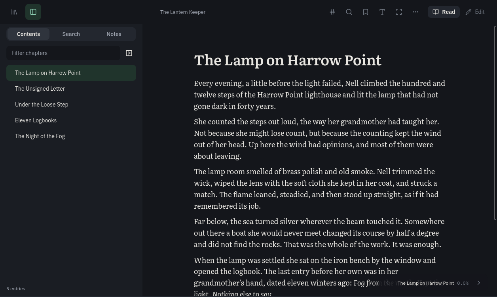
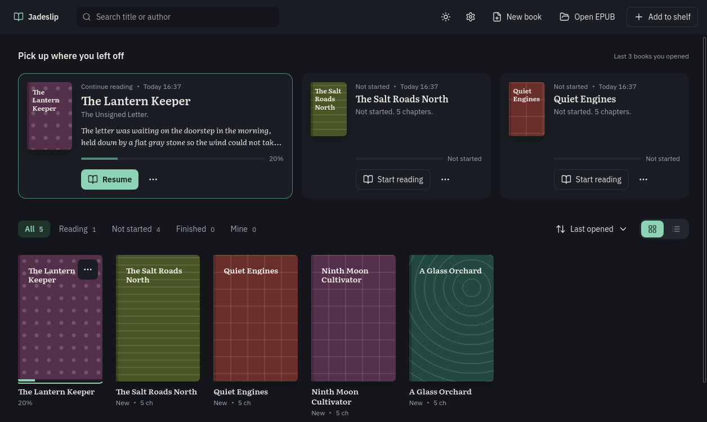
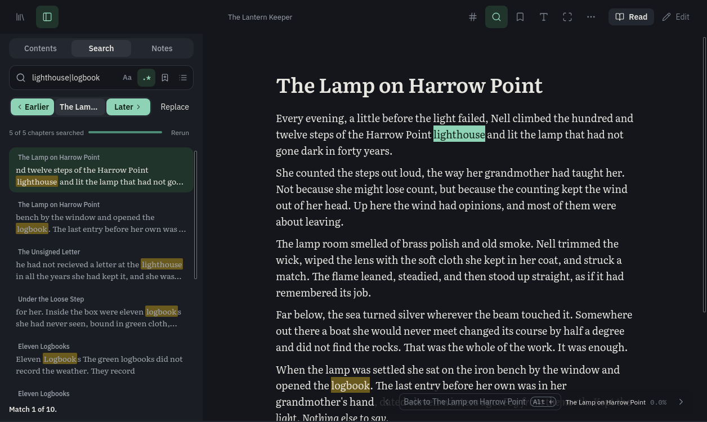

<div align="center">


# Jadeslip

**A fast desktop EPUB reader that lets you fix the book while you read it.**

Open a 6,000-chapter web novel in about a quarter of a second, spot a typo, press <kbd>E</kbd>, fix it, press <kbd>Esc</kbd>. Done. The fix is saved back into the EPUB.

[](LICENSE)
[](https://www.rust-lang.org)
[](https://tauri.app)
[](#install)
[](app/ui)



</div>

---

## Why

Calibre is great, but opening a huge web novel in it is slow, and fixing one wrong word means launching a whole separate editor. Jadeslip is built for exactly that case:

- **Huge books open instantly.** It reads only the index of the EPUB, never unpacks it to disk, and loads chapters on demand.
- **Reading and editing are one switch.** The same view, the same place in the chapter. A typo fix is a two-second interruption, not a context switch.
- **Your book is safe.** Saves are atomic, a no-change save leaves the file byte-for-byte identical, and there is always a way back.

## Features

| | |
|---|---|
| 📚 **Library** | A shelf with generated covers, progress, search, sort, and "pick up where you left off". |
| 📖 **Reader** | Contents sidebar, light and dark themes, adjustable font, width, margins and spacing, scroll or page view, focus mode, full screen. Your place is remembered. |
| ✏️ **Edit in place** | Press <kbd>E</kbd> to edit the chapter you are reading, <kbd>Esc</kbd> to save and go back. Bold, italic, headings, lists, undo across saves. |
| 🔎 **Whole-book search** | Plain or regex (with lookaround), across the whole book or only before or after the chapter you are on, so a lookup never spoils what comes next. Results stream in as it searches, click a result to jump to the exact match. |
| 🔁 **Book-wide replace** | Preview every change, then apply it across all chapters as one save. **Fix everywhere** offers to fix the other copies of a word you just corrected. |
| 🔤 **Spell check** | English built in, any Hunspell dictionary can be added. Suggestions and "add to dictionary" on right-click. |
| 🧹 **Clean up book** | One save removes web-novel junk: watermark lines, translator notes and support requests, and repeated chapter titles. It also fixes chapter titles to their number and name. Counts per rule first, and every match can be reviewed. From the book's menu on the shelf or **More** in the reader. |
| 🗂️ **Chapters** | Add, rename, reorder and delete chapters. The contents, spine and navigation stay consistent, so the book stays a valid EPUB. |
| 🕰️ **History and backups** | A backup from before your first edit, automatic history on every save, named snapshots, word-by-word compare, and crash-recovery drafts. |
| 🔖 **Bookmarks and notes** | Stored in Jadeslip's data folder, never inside the book. They find their place again after edits. |
| ⚡ **Quick jump** | <kbd>Ctrl</kbd>+<kbd>K</kbd> to jump to a chapter by number or title, or run a command. |
| ✍️ **Write your own** | Start a new book and write it chapter by chapter. |

## Screenshots

<table>
  <tr>
    <td width="50%"></td>
    <td width="50%"></td>
  </tr>
  <tr>
    <td align="center"><sub><b>Library.</b> Your shelf, with where you left off up top.</sub></td>
    <td align="center"><sub><b>Search.</b> Plain or regex, across every chapter.</sub></td>
  </tr>
  <tr>
    <td width="50%"></td>
    <td width="50%"></td>
  </tr>
  <tr>
    <td align="center"><sub><b>Edit.</b> Fix it right where you read it.</sub></td>
    <td align="center"><sub><b>Light theme.</b> Plus fonts, width, margins and page view.</sub></td>
  </tr>
</table>

<sub>The books in the screenshots are short samples written for this README and generated by <code>crates/fixtures</code>.</sub>

## How fast

Measured on the author's machine, from launching the app to book text on screen, median of at least 5 runs:

| Book | Jadeslip | Calibre viewer (first open) | Calibre viewer (later opens) | Calibre editor |
|---|---:|---:|---:|---:|
| 6,000 generated chapters | **268 ms** | 3,226 ms | 1,524 ms | 1,882 ms |
| 6,193-chapter real novel | **261 ms** | 3,163 ms | 1,560 ms | 1,929 ms |
| Memory at first text | **~300 MB** | ~690 MB | ~690 MB | ~680 MB |

Other numbers: a one-chapter save takes about 55 ms, and a plain search through the largest book takes 42 to 61 ms. Method, raw data and scripts are in [`bench/calibre/`](bench/calibre/REPORT.md). Those measurements were taken before the app was renamed, so the bench files still call it SpineSprint.

## Install

Jadeslip is Linux-first (developed on Hyprland/Wayland).

There are no prebuilt downloads. Build it from source. What changed in each version is in [`CHANGELOG.md`](CHANGELOG.md).

**1. Get the dependencies.** Rust (stable, 2024 edition) and the WebKitGTK 4.1 development files:

```sh
# Arch
sudo pacman -S --needed rust webkit2gtk-4.1 base-devel

# Debian / Ubuntu
sudo apt install build-essential curl libwebkit2gtk-4.1-dev libgtk-3-dev libsoup-3.0-dev
curl --proto '=https' --tlsv1.2 -sSf https://sh.rustup.rs | sh
```

On Debian and Ubuntu, Rust comes from rustup because the packaged Rust is too old. Open a new terminal afterwards, or run `. ~/.cargo/env`, so `cargo` is found.

**2. Run it straight from the repo:**

```sh
cargo run --release -p jadeslip               # opens the library
cargo run --release -p jadeslip -- book.epub  # opens a book
```

**3. Or install a self-contained copy** into a folder of your choice:

```sh
scripts/install-local.sh ~/.local/opt/jadeslip
~/.local/opt/jadeslip/bin/jadeslip book.epub
```

This puts the app and its regex worker side by side, which regex search needs. Keep them together if you move the folder. More detail, including how to add spell-check dictionaries for other languages, is in [`docs/INSTALL.md`](docs/INSTALL.md).

## Using it

| Key | Does |
|---|---|
| <kbd>E</kbd> / <kbd>Esc</kbd> | Edit this chapter / save and go back to reading |
| <kbd>←</kbd> <kbd>→</kbd> | Previous / next chapter (or page in page view) |
| <kbd>Space</kbd> | Down a screen, then on to the next chapter |
| <kbd>Ctrl</kbd>+<kbd>K</kbd> | Jump to a chapter or run a command |
| <kbd>Ctrl</kbd>+<kbd>F</kbd> | Search the whole book |
| <kbd>Ctrl</kbd>+<kbd>T</kbd> | Show or hide the contents |
| <kbd>Ctrl</kbd>+<kbd>D</kbd> | Bookmarks and notes |
| <kbd>Ctrl</kbd>+<kbd>Shift</kbd>+<kbd>A</kbd> | Text size, font and spacing |
| <kbd>Ctrl</kbd>+<kbd>,</kbd> | Preferences: theme, page view, spelling, storage |
| <kbd>F</kbd> | Focus mode, only the text |
| <kbd>F11</kbd> | Full screen |
| <kbd>F1</kbd> or <kbd>?</kbd> | Every shortcut |

**Where your stuff lives.** Books you add to the shelf are copied into `~/.local/share/jadeslip/library/`, and Jadeslip edits that copy, never your original. A book opened with **Open EPUB** or from the command line is edited where it is. Reading positions, history, backups, bookmarks and your word list live in `~/.local/share/jadeslip/` and never inside the EPUB.

**Command line.**

```sh
jadeslip info book.epub          # title, author, chapter list
jadeslip extract book.epub 3     # print the source of spine item 3
jadeslip clean-report book.epub  # what each clean-up rule finds
```

## Safety

Every EPUB is treated as untrusted. Jadeslip limits decompressed size and XML depth, rejects path tricks inside the archive, blocks a book's scripts and remote resources, and only opens external links when you click them.

Saving writes a new file and swaps it in atomically, keeping the file's permissions. The test suite kills the app at every step of a save and checks that you always end up with either the old book or the new one, never a mix. The save and backup protocol is also model-checked with TLA+ ([`.claude/skills/verify-book-commit/`](.claude/skills/verify-book-commit/SKILL.md)).

## Project layout

```
app/            Tauri shell: Rust commands plus the UI in plain HTML, CSS and JS (no bundler)
crates/core/    The library: EPUB parsing, search, editing, saving, history, spelling
crates/worker/  Regex search runs here, in its own process, apart from the core
crates/fixtures Generates test books, including hostile ones
tests/          Real-app end-to-end suites, mutation runners and checks
bench/calibre/  The Calibre comparison benchmark
docs/           Design notes, the install guide and the UI mockup
```

The core has no Tauri dependency, so everything that touches a book can be tested without a window.

## Development

```sh
cargo run --release -p jadeslip-fixtures --bin gen-fixtures   # generate the test books once
cargo test --workspace     # unit and integration tests
scripts/verify.sh quick    # tests, clippy for both builds, and the repo's style checks
scripts/verify.sh full     # plus every real-app suite
scripts/screenshots.sh     # retake the README screenshots in the real app
```

`verify.sh` also runs the tests that need real books. Those aren't in the repo, so put a few EPUBs of your own in `fixtures/real/` first (the folder is gitignored). The real-app suites in `full` drive the actual window with real clicks and key presses on a hidden Hyprland output, so they need Hyprland.

House rules: no code comments, and the design decisions live in [`docs/DESIGN.md`](docs/DESIGN.md).

## License

[MIT](LICENSE). The bundled English spelling dictionary comes from SCOWL by way of LibreOffice and keeps its own license notices, in [`crates/core/dict/`](crates/core/dict/README_en_US.txt).
